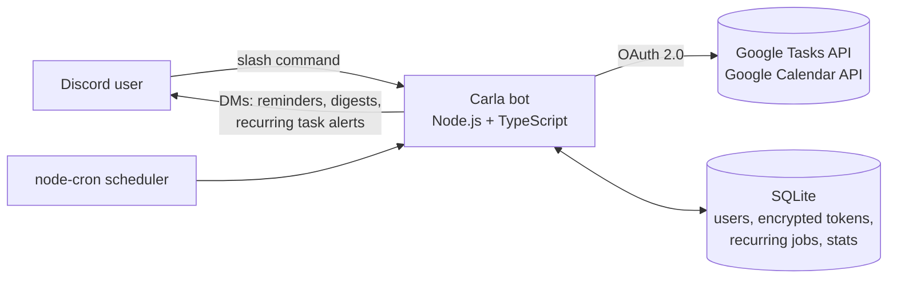

# Carla AI


A Discord bot that manages your **Google Tasks** and **Google Calendar** with slash commands, plus scheduled automations: recurring tasks, event reminders and a daily digest, all delivered by DM.

Built with Node.js, TypeScript, discord.js, the Google APIs, SQLite and cron, and deployed on AWS EC2.

## Features

- **Google Tasks CRUD**: add, list, complete, reopen, update and delete tasks.
- **Google Calendar CRUD**: add, list, update and delete events. Plain-English times ("tomorrow 3pm", "next fri") and all-day events.
- **Recurring tasks (cron)**: e.g. "every weekday at 8am, add *Check email*". Each user's jobs run in their own timezone.
- **Event reminders**: a DM N minutes before each calendar event.
- **Daily digest**: a morning DM with today's events and tasks due.
- **Autocomplete everywhere**: start typing a task or event name and pick it from the list.
- **Private by default**: every reply is ephemeral (only you can see it).
- **Secure OAuth**: Google refresh tokens are encrypted at rest with AES-256-GCM; the link flow is protected by a one-time `state` value.
- **Usage stats**: owner-only `/stats` with pseudonymous counts (no message content stored).

## Commands

| Command | What it does |
| --- | --- |
| `/google connect` · `status` · `disconnect` | Link or unlink your Google account |
| `/tasks add` · `list` · `complete` · `reopen` · `update` · `delete` | Google Tasks |
| `/calendar add` · `list` · `update` · `delete` | Google Calendar (primary calendar) |
| `/recurring add` · `list` · `delete` | Tasks created automatically on a schedule |
| `/settings timezone` · `reminders` · `digest` | Personal settings |
| `/stats` | Usage numbers (bot owner only) |
| `/help` | Command overview |

## How it works



- **Interaction router** (`src/index.ts`) defers every command as an ephemeral reply, then dispatches to the command module. Friendly errors (`UserFacingError`) are shown to the user; anything else is logged.
- **Google layer** (`src/google/`) caches one OAuth client per user, refreshes access tokens automatically, and translates Google errors (expired grant, 404, rate limits) into readable messages.
- **Scheduler** (`src/scheduler.ts`) runs one cron job per recurring task in the user's timezone, plus a once-a-minute tick for digests and reminders. Sent reminders are recorded in SQLite so nobody gets duplicates after a restart.

## Setup

You need **Node.js 22+**, a Discord account and a Google account.

### 1. Create the Discord application

1. Go to the [Discord Developer Portal](https://discord.com/developers/applications) → **New Application** → name it *Carla AI*.
2. **Bot** tab → **Reset Token** → copy it into `DISCORD_TOKEN`. No privileged intents are needed.
3. **General Information** → copy the **Application ID** into `DISCORD_CLIENT_ID`.
4. **Installation** → under *Guild Install* add the scopes `applications.commands` and `bot`, and the permissions *Send Messages* and *Embed Links*. Open the install link and add the bot to your server.
5. In Discord, turn on **Developer Mode** (Settings → Advanced). Right-click your server → *Copy Server ID* → `DISCORD_GUILD_ID`. Right-click yourself → *Copy User ID* → `OWNER_ID`.

### 2. Create the Google Cloud credentials

1. In the [Google Cloud Console](https://console.cloud.google.com/), create a project called *Carla AI*.
2. **APIs & Services → Library**: enable **Google Tasks API** and **Google Calendar API**.
3. **OAuth consent screen** (Google Auth Platform): choose *External*, fill in the app name and your email, add the scopes `.../auth/tasks` and `.../auth/calendar.events`, and add your Gmail as a **test user**.
4. **Clients → Create client → Application type: Desktop app**. Copy the client ID and secret into `GOOGLE_CLIENT_ID` and `GOOGLE_CLIENT_SECRET`.
5. **Important:** while the app is in *Testing*, Google expires refresh tokens after 7 days. For a bot that should stay connected, go to **Audience → Publish app**. Unverified apps show a "Google hasn't verified this app" screen (click *Advanced → continue*) and are limited to 100 users, which is fine for a personal or portfolio bot.

> **Why Desktop app?** Linking uses Google's loopback flow: after you approve, Google redirects to `http://localhost`, the page doesn't load, and you paste that URL back into Discord. This means the server needs no public web endpoint or domain.

### 3. Configure and run

```bash
cp .env.example .env          # then fill in the values
node -e "console.log(require('crypto').randomBytes(32).toString('hex'))"   # paste into TOKEN_ENCRYPTION_KEY

npm install
npm run register              # registers the slash commands with Discord
npm run dev                   # starts the bot with auto-reload
```

In Discord, run `/google connect`, then `/settings timezone`, then try `/tasks add title:Test due:tomorrow`.

> For reminders and digests, users need **Allow direct messages from server members** turned on for the server the bot is in.

### Scripts

| Script | Purpose |
| --- | --- |
| `npm run dev` | Run from source with auto-reload (tsx) |
| `npm run build` / `npm start` | Compile to `dist/` and run the compiled bot |
| `npm run typecheck` | TypeScript checks without emitting |
| `npm test` | Unit tests (Node's built-in test runner) |
| `npm run register` | Register slash commands (`register:prod` uses the compiled build) |

## Deployment

The bot runs 24/7 on an AWS EC2 instance under PM2. See **[docs/DEPLOY_AWS.md](docs/DEPLOY_AWS.md)**.

## Security and privacy

- `.env` and the `data/` folder (the SQLite database) are git-ignored. Never commit them.
- Google refresh tokens are encrypted with AES-256-GCM using `TOKEN_ENCRYPTION_KEY`. Changing that key forces everyone to reconnect.
- `/google disconnect` revokes Carla's access at Google; `delete_data:true` also wipes the user's settings and recurring tasks.
- Usage stats store only a keyed hash of each Discord ID and the command name, never task or event contents.

## Project structure

```
src/
  index.ts             Discord client + interaction router
  deploy-commands.ts   Registers slash commands
  config.ts            Environment variables
  crypto.ts            Token encryption, pseudonymous IDs
  db.ts                SQLite schema and queries
  scheduler.ts         Cron jobs: recurring tasks, digests, reminders
  schedule.ts          Pure cron/time helpers (unit tested)
  format.ts, util.ts   Display helpers, natural-language date parsing
  google/              OAuth, Tasks and Calendar wrappers
  commands/            One file per slash command
tests/                 Unit tests
docs/                  Deployment and GitHub guides
```

## License

MIT
